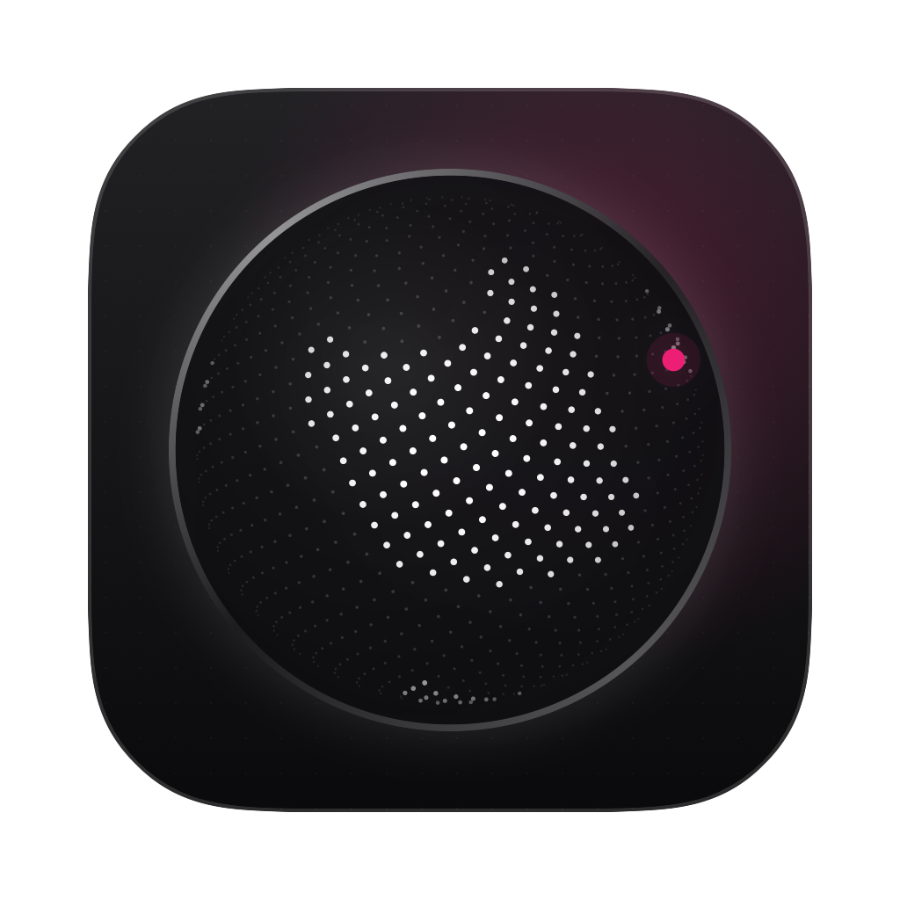
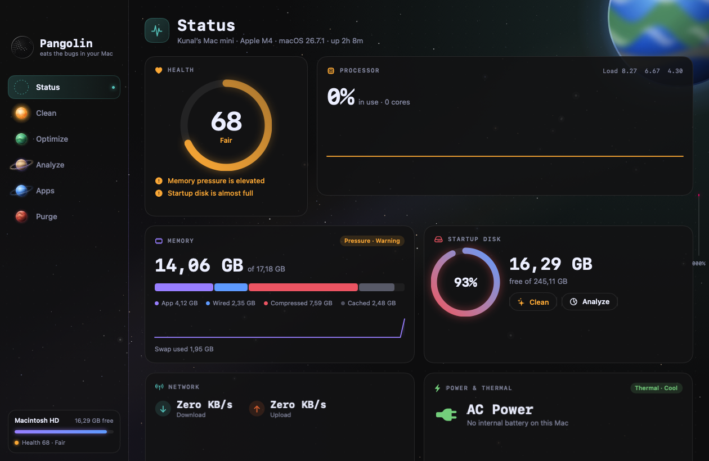
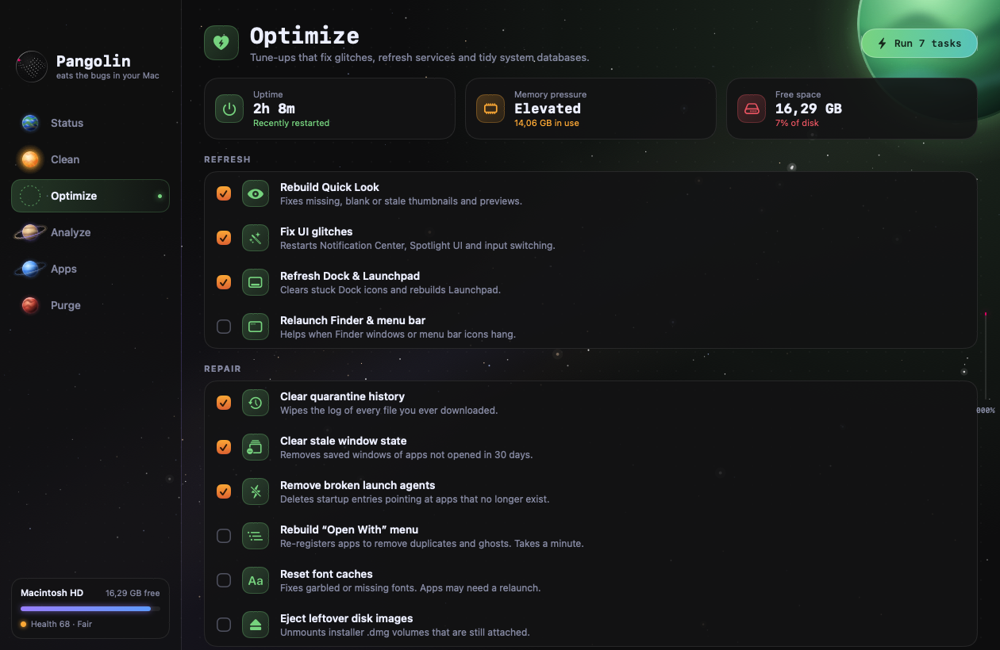
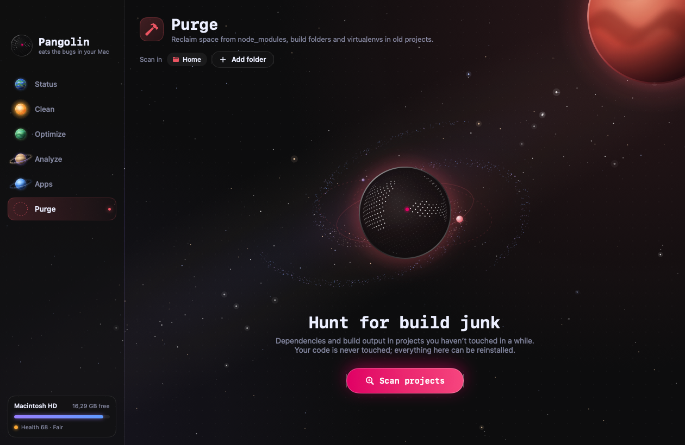

<p align="center">
  
</p>

<h1 align="center">Pangolin</h1>

<p align="center">
  <b>Eats the bugs in your Mac.</b><br>
  A free, open-source Mac cleaner and system monitor with a black-galaxy design.
</p>

<p align="center">
  <a href="https://github.com/kunalsharmavlog-hue/pangolin/releases/latest"></a>
  
  
  <a href="LICENSE"></a>
</p>

<p align="center">
  
</p>

A native macOS app that keeps your Mac clean and fast, in the spirit of [Mole](https://github.com/tw93/Mole), with a black-galaxy design inspired by [weevolveit.com](https://weevolveit.com/).

Pangolin is named after the scaly animal that sniffs out ants and termites and eats them. This one hunts down the junk in your Mac.

- **Status**: live health score, CPU, memory, disk, network, battery and top processes
- **Clean**: caches, logs, developer junk, Premiere / After Effects media caches, old installers, the Trash
- **Optimize**: one-click fixes for glitches plus deeper system maintenance
- **Analyze**: see what's eating your disk, folder by folder
- **Apps**: full uninstaller, leftovers from deleted apps, startup items
- **Purge**: `node_modules`, build folders and virtualenvs in old projects
- **Menu bar**: a small live monitor that's always one click away

Free, with no account, ads, or tracking. Built with SwiftUI. No third-party dependencies.

---

## Install

### Download (easiest)

1. Download **Pangolin.dmg** from the [latest release](https://github.com/kunalsharmavlog-hue/pangolin/releases/latest).
2. Open it and drag **Pangolin** into **Applications**.
3. The first time, **right-click Pangolin → Open**, then click **Open**. (The app isn't notarized by Apple, so macOS asks once.)
4. Give it Full Disk Access (see below) so it can find everything.

### Build from source

#### Requirements

- macOS 15 or later (Apple Silicon or Intel)
- Apple's Command Line Tools (`xcode-select --install`). Full Xcode is **not** needed.

#### Build and install

```bash
git clone https://github.com/kunalsharmavlog-hue/pangolin.git
cd pangolin
./build.sh --install
```

This compiles the app, generates its icon, and copies `Pangolin.app` into `/Applications`. Open it from Launchpad or Spotlight.

To build without installing (the app lands in `build/Pangolin.app`):

```bash
./build.sh
```

> The build script uses the macOS 26 SDK that ships with the Command Line Tools. The macOS 27 SDK needs SwiftUI macro plugins that only come with full Xcode. If you have Xcode installed you can override this with `SDKROOT=... ./build.sh`.

### First launch: give it Full Disk Access

macOS hides some folders (Safari, Mail, the Trash, some app data) until you allow it:

1. Open **System Settings → Privacy & Security → Full Disk Access**.
2. Click **+**, choose **/Applications/Pangolin.app**, and switch it on.
3. Quit and reopen Pangolin.

The Clean screen shows an **Open Settings** button that takes you straight there. Pangolin works without it; it just finds less.

The app is ad-hoc signed (not notarized). If macOS blocks the first launch, right-click the app → **Open**, or allow it under **System Settings → Privacy & Security**.

---

## Using Pangolin

When it opens, a galaxy turns in the middle of the window and the dotted-globe logo forms from the stars, then flies into the sidebar. Pick a section from the sidebar, or press **⌘1** to **⌘6**. Each section has its own planet that flies out onto the page when you select it.

### Status (⌘1)

A live dashboard, refreshed every 2 seconds.

| Card | What it shows |
| --- | --- |
| Health | A 0–100 score and anything dragging it down (high CPU, memory pressure, low disk, long uptime, heat, battery wear, heavy swap) |
| Processor | Overall CPU %, a 2-minute history and a bar per core |
| Memory | Used vs total, broken down into App / Wired / Compressed / Cached, plus memory pressure and swap |
| Startup Disk | Free space, with shortcuts to **Clean** and **Analyze** |
| Network | Live download and upload speed |
| Power & Thermal | Battery %, health, cycle count and temperature (on laptops), and how hot the Mac is running |
| Top Processes | The 8 busiest processes by CPU or Memory. Hover a row and click **×** to quit it |

### Clean (⌘2)

1. Click **Scan for junk**. Pangolin checks every category and shows how much it found.
2. Click a category to expand it and see each item. Tick or untick items; the checkbox on the category toggles all of them.
3. Click **Clean** and confirm.

What it looks at:

| Category | What it is | What happens to it |
| --- | --- | --- |
| App caches | `~/Library/Caches` for each app (Apple's own are unticked by default) | Deleted; apps rebuild them |
| Browser caches | Chrome, Safari, Firefox, Arc, Brave, Edge, Opera, Vivaldi. **History, bookmarks and logins are never touched** | Deleted |
| Creative app caches | Premiere & After Effects media cache and peak files, Final Cut, DaVinci Resolve, Motion. **Quit those apps first** | Deleted |
| Developer junk | Xcode DerivedData, device support, simulator caches, Homebrew, npm, yarn, pnpm, pip, uv, Cargo, Go, Gradle, Bun, CocoaPods, JetBrains. Xcode Archives are unticked | Deleted |
| Logs | App logs in `~/Library/Logs` | Deleted |
| Crash reports | Old crash and hang reports | Deleted |
| Installers | `.dmg`, `.pkg`, `.iso`, `.xip` in Downloads and Desktop. Only ones older than a week are ticked | Moved to Trash |
| Mail attachments | Files Mail already downloaded | Moved to Trash |
| iPhone & iPad backups | Local device backups. **Unticked by default** | Moved to Trash |
| Trash | What's already in your Trash | Emptied |

**Safe mode:** switch on *"Safe mode: move everything to Trash"* in the bottom bar to send everything to the Trash instead of deleting it, so you can put anything back.

### Optimize (⌘3)

Tick the tasks you want and click **Run**. Each one shows ✓, *skipped* (nothing needed doing) or an error.

**Refresh**
- *Rebuild Quick Look*: fixes blank or stale thumbnails and previews
- *Fix UI glitches*: restarts Notification Center, Spotlight UI and input switching
- *Refresh Dock & Launchpad*
- *Relaunch Finder & menu bar*

**Repair**
- *Clear quarantine history*: wipes the record of every file you've downloaded
- *Clear stale window state*: saved windows of apps you haven't opened in 30 days
- *Remove broken launch agents*: startup entries that point at apps that no longer exist (moved to Trash)
- *Rebuild "Open With" menu*: removes duplicate and ghost apps (takes a minute)
- *Reset font caches*
- *Eject leftover disk images*

**Deep maintenance** (🔒 asks for your password once, for all of them together)
- *Flush DNS cache*: fixes sites that won't load after a network change
- *Free inactive memory*: handy before a heavy render
- *Run maintenance scripts*: macOS's daily, weekly and monthly housekeeping
- *Reindex Spotlight*: rebuilds search from scratch

### Analyze (⌘4)

- Opens on your home folder and sizes every item in it.
- **Click a folder** to go inside. Use the breadcrumbs at the top to go back up.
- **Location** switches to Macintosh HD, an external drive, or any folder you choose.
- **Hidden** shows hidden files and folders.
- The ring chart on the right breaks down the current folder.
- **Right-click** any item to reveal it in Finder, open it, or move it to the Trash.

When analyzing Macintosh HD, system areas (`/System`, `/private`, `/usr` and so on) are skipped.

### Apps (⌘5)

Three tabs at the top right:

**Applications**: complete uninstaller
1. Search or sort (by size, name, or least recently used).
2. Click an app. Pangolin finds its leftovers: support files, caches, containers, preferences, saved state, cookies, web data, startup agents and helpers, including system-wide ones in `/Library`.
3. Untick anything you want to keep, then click **Uninstall**. The app is quit if it's running, and the app plus its leftovers go to the Trash. Root-owned files ask for your password.

Safari and Pangolin itself can't be uninstalled.

**Leftovers**: data from apps you already deleted
- Click **Find leftovers**. Pangolin lists app data whose app is no longer installed, grouped by app.
- **Nothing is ticked by default.** Review each group (expand it to see the paths), tick what you want gone, and click **Remove**. Items go to the Trash.
- Groups marked *active recently* were touched in the last week, so be careful with those.

**Startup**: background launch items
- Lists agents and daemons that start automatically: *Just you*, *All users* and *System*.
- Flip the switch to turn one off (it stops at the next login). System items ask for your password.
- Hover a row to reveal its file in Finder or remove it.
- *app missing* marks items whose program no longer exists.
- **Login Items Settings** opens the macOS page for apps that open at login.

### Purge (⌘6)

Frees space taken up by project dependencies and build output. Your source code is never touched.

1. Choose where to look. Home is the default; click **Add folder** to add more (an external drive, for example).
2. Click **Scan projects**.
3. Pangolin lists folders it can safely remove, each with its project and size:
   `node_modules`, `.next`, `.nuxt`, `.svelte-kit`, `.turbo`, `.parcel-cache`, `.angular`, Rust/Maven `target`, Gradle/CMake/Flutter `build`, `.gradle`, `Pods`, `.dart_tool`, Composer `vendor`, Python `.venv` / `venv`, `DerivedData`.
   A folder only counts when its project file (such as `package.json` or `Cargo.toml`) is next to it.
4. Projects edited in the last week are unticked. Click **Purge** to delete the ticked folders.

Bring dependencies back any time with `npm install`, `cargo build`, `pip install -r requirements.txt`, and so on.

### Menu bar

The hexagon icon in the menu bar opens a small panel with your health score, CPU, memory, free disk, network speed and the top 3 processes. **Open Pangolin** brings up the main window; **Clean** jumps straight to the Clean screen. Closing the main window keeps Pangolin running in the menu bar. Use the power button there to quit.

### Keyboard shortcuts

| Shortcut | Action |
| --- | --- |
| ⌘1 – ⌘6 | Status, Clean, Optimize, Analyze, Apps, Purge |
| Return | Start the scan on a start screen |
| ⌘Q | Quit |

### Screens

| Optimize | Purge |
| --- | --- |
|  |  |


---

## Safety

- Nothing is removed until you click the button and confirm.
- Anything that can't be rebuilt automatically (installers, attachments, backups, uninstalled apps, leftovers) goes to the **Trash**, not straight to deletion.
- Leftovers from deleted apps and device backups start **unticked**.
- Every action is logged to `~/Library/Logs/Pangolin/operations.log`: one line per item with the time, the section, what happened, the path and its size.
- Files that are in use or protected by macOS are skipped and counted in the result.

---

## Project layout

```
Sources/Pangolin/
  PangolinApp.swift   App entry, window, sidebar, planet match cut, menu bar
  Theme.swift         Colours, type, buttons, cards and shared components
  Space.swift         Starfield, planets, galaxy, orbit scene, warp transition
  Globe.swift         Dotted-globe logo, dot grid, scroll motion
  SystemMonitor.swift CPU, memory, disk, network, battery, processes
  StatusView.swift    Status screen
  CleanEngine.swift   What Clean scans and how it removes it
  CleanView.swift     Clean screen
  Optimize.swift      Optimize tasks and screen
  Analyze.swift       Disk explorer
  AppsEngine.swift    Uninstaller, leftovers, startup items
  AppsView.swift      Apps screen
  Purge.swift         Project build-artifact finder
  BrandAssets.swift   Renders the logo, wordmarks and social images in brand/
  Util.swift          File sizing, shell, Trash, logging, icon cache
Resources/Info.plist
build.sh              Build, icon generation, signing, install, DMG (--dmg)
brand/                Logo, wordmarks and social images
docs/screenshots/     README screenshots
```

### Developer extras

```bash
# Render the 1024px app icon
.build/release/Pangolin --render-icon icon.png

# Render the launch screen and every section to PNGs for design review
build/Pangolin.app/Contents/MacOS/Pangolin --snapshot ./snapshots

# Open on a given section with parts switched off (for profiling)
PGDBG="pane=analyze,nostars,noplanet" build/Pangolin.app/Contents/MacOS/Pangolin
```

---

## Contributing

Issues and pull requests are welcome. Please describe your Mac model and macOS version, and
for anything that deletes files, say exactly which paths were affected (see
`~/Library/Logs/Pangolin/operations.log`).

## License

MIT, see [LICENSE](LICENSE).

---

Made by Kunal ([@kunalsharmavlog-hue](https://github.com/kunalsharmavlog-hue)). Also by Kunal:
[Revive](https://github.com/kunalsharmavlog-hue/revive) (free data recovery for Mac) and
[Focus Feed](https://github.com/kunalsharmavlog-hue/focus-feed) (keep Instagram on-topic).

Inspired by [Mole](https://github.com/tw93/Mole) by tw93. Pangolin is an independent app and shares no code or artwork with it.
